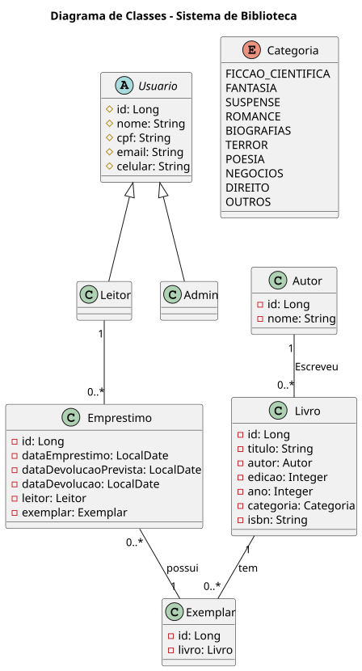
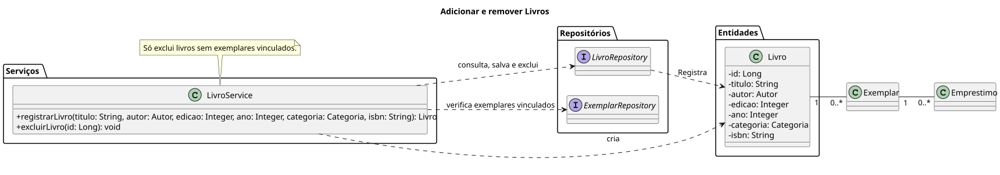
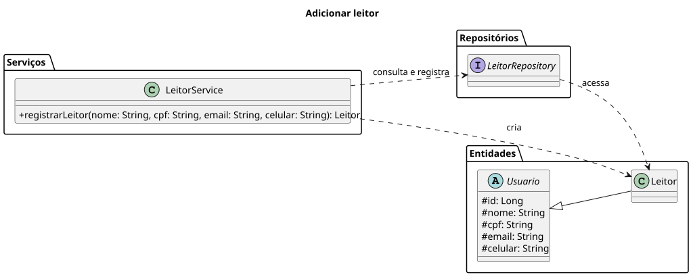
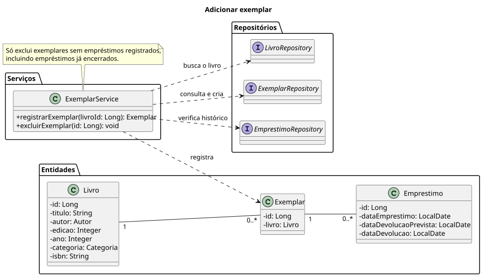
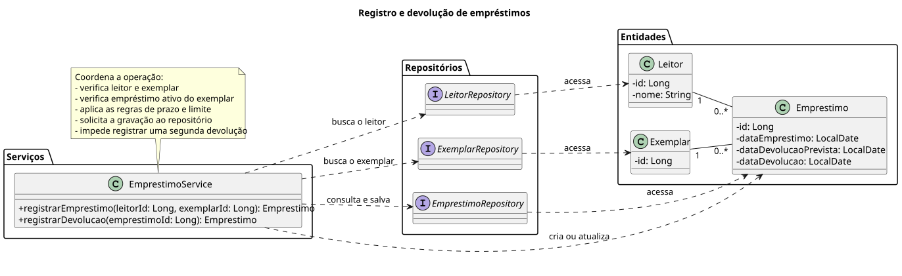

# Biblioteca API

API de gerenciamento de biblioteca criada para estudar Java, Spring Boot e PostgreSQL. O modelo inclui livros, autores, exemplares, leitores, administradores e empréstimos.

## Estado atual

As entidades JPA, os repositories, os services, os DTOs e os seis controllers estão implementados. A API tem endpoints de cadastro, listagem e busca por ID para autores, livros, leitores, administradores, exemplares e empréstimos, além do registro de devolução.

O empréstimo usa a data atual, prazo de 14 dias e limite de três empréstimos ativos por leitor. O service rejeita um exemplar já emprestado e uma segunda devolução do mesmo empréstimo em operações sequenciais.

A próxima etapa é implementar tratamento de erros HTTP e validar os fluxos com PostgreSQL. Ainda faltam testes das regras e endpoints, proteção contra operações simultâneas, atualização e exclusão de cadastros e consultas de empréstimos ativos e atrasados. Autenticação e autorização ficam para uma evolução futura.

Os comportamentos descritos nesta página refletem a leitura do código. A execução completa e os cenários de erro ainda precisam ser verificados.

## Tecnologias

| Tecnologia | Uso |
| --- | --- |
| Java 21 | Linguagem do projeto |
| Spring Boot 4.1.1 | Configuração e inicialização da aplicação |
| Spring Web MVC | Controllers e endpoints HTTP |
| Spring Data JPA / Hibernate | Mapeamento das entidades e persistência |
| Jakarta Validation | Validação dos requests e das entidades |
| PostgreSQL | Banco de dados |
| Maven Wrapper | Build e execução |
| PlantUML | Diagramas de classes e serviços |

As versões de Java e Spring Boot estão definidas no [pom.xml](pom.xml).

## Modelo de domínio

- Autor: nome e identificação do autor de um livro.
- Livro: título, autor, categoria, edição, ano e ISBN.
- Exemplar: unidade de um livro que pode ser emprestada.
- Usuario: classe base de `Leitor` e `Admin`, com nome, CPF, e-mail e celular.
- Leitor: usuário que realiza os empréstimos.
- Admin: cadastro de administrador.
- Emprestimo: registro do empréstimo de um exemplar a um leitor, com datas de empréstimo, devolução prevista e devolução efetiva.

Um autor pode ter vários livros, e cada livro pode ter vários exemplares. Cada empréstimo pertence a um leitor e a um exemplar. Ambos podem ter vários registros de empréstimo ao longo do tempo.

## Serviços

Além do cadastro, todos os services têm os métodos `findAll` e `findById`.

| Serviço | O que faz hoje |
| --- | --- |
| `AutorService` | Cadastra autores. Rejeita ID preenchido e nome vazio, remove espaços nas pontas do nome e verifica nome existente ignorando maiúsculas e minúsculas. |
| `LivroService` | Cadastra livros com ISBN obrigatório e único. Busca o autor pelo ID ou pelo nome informado; na busca por nome, cria o autor se não o encontrar. |
| `LeitorService` | Cadastra leitores com nome, CPF, e-mail e celular obrigatórios. Verifica se o CPF ou o e-mail já estão cadastrados. |
| `AdminService` | Cadastra administradores com verificações semelhantes às do cadastro de leitores. |
| `ExemplarService` | Cadastra exemplares sem ID preenchido, exige o ID de um livro existente e associa o livro encontrado. |
| `EmprestimoService` | Busca leitor e exemplar cadastrados, verifica disponibilidade e limite de três empréstimos ativos, calcula o prazo de 14 dias e registra a devolução, rejeitando repetição. |

Um empréstimo é considerado ativo enquanto `dataDevolucao` for nula, mesmo se estiver atrasado. As verificações de disponibilidade, limite e devolução ainda precisam de proteção contra requisições simultâneas. A reutilização de autores pelo nome considera nomes iguais como o mesmo autor nesta versão; a unicidade dessa comparação ainda precisa ser garantida no banco.

## Endpoints implementados

Endereço local padrão: `http://localhost:8080`.

| Recurso | Cadastrar | Listar | Buscar por ID |
| --- | --- | --- | --- |
| Autores | `POST /autores` | `GET /autores` | `GET /autores/{id}` |
| Livros | `POST /livros` | `GET /livros` | `GET /livros/{id}` |
| Leitores | `POST /leitores` | `GET /leitores` | `GET /leitores/{id}` |
| Administradores | `POST /admins` | `GET /admins` | `GET /admins/{id}` |
| Exemplares | `POST /exemplares` | `GET /exemplares` | `GET /exemplares/{id}` |
| Empréstimos | `POST /emprestimos` | `GET /emprestimos` | `GET /emprestimos/{id}` |

Devolução: `POST /emprestimos/{id}/devolucao`, sem corpo de requisição.

Os cadastros retornam `201 Created`; as consultas e a devolução bem-sucedida retornam `200 OK`. As respostas usam DTOs, e os requests de cadastro são validados com `@Valid`. Ainda não há tratamento próprio que traduza as exceções dos services em respostas 400, 404 ou 409.

### Exemplos de requisições

Envie os cadastros com `Content-Type: application/json`.

Cadastro de autor (`POST /autores`):

```json
{
  "nome": "Machado de Assis"
}
```

Cadastro de livro (`POST /livros`):

```json
{
  "titulo": "Dom Casmurro",
  "nomeAutor": "Machado de Assis",
  "edicao": 1,
  "ano": 2020,
  "categoria": "ROMANCE",
  "isbn": "9780000000000"
}
```

Os dados de edição e ISBN acima são ilustrativos. Se informar `autorId`, o sistema busca esse autor e prioriza o ID. Sem ID, exige `nomeAutor`, reutiliza o autor encontrado pelo nome ou cadastra um novo.

Cadastro de exemplar (`POST /exemplares`):

```json
{
  "livroId": 1
}
```

Registro de empréstimo (`POST /emprestimos`):

```json
{
  "leitorId": 1,
  "exemplarId": 1
}
```

Use IDs existentes no seu banco. As datas são preenchidas pelo service. Para cadastrar leitor ou administrador, informe `nome`, `cpf` no formato `000.000.000-00`, `email` e `celular`. A validação atual do CPF verifica o formato; a verificação dos dígitos verificadores ainda não foi implementada.

## Diagramas

As fontes estão em [docs/diagramas](docs/diagramas). Os diagramas de serviços mostram o fluxo planejado, incluindo operações e verificações que ainda faltam no código. Algumas assinaturas também são diferentes: os métodos atuais recebem objetos de entidade. A seção de serviços descreve o que já foi implementado.

### Classes do domínio



[Fonte PlantUML](docs/diagramas/classes.puml)

### LivroService



[Fonte PlantUML](docs/diagramas/livro-service.puml)

### LeitorService



[Fonte PlantUML](docs/diagramas/leitor-service.puml)

### ExemplarService



[Fonte PlantUML](docs/diagramas/exemplar-service.puml)

### EmprestimoService



[Fonte PlantUML](docs/diagramas/emprestimo-service.puml)

As imagens SVG são versionadas junto dos `.puml` e aparecem no README. Depois de editar um diagrama, gere as imagens novamente com o PlantUML instalado localmente:

```powershell
java -jar plantuml.jar -charset UTF-8 -tsvg docs/diagramas/*.puml
```

Para executar esse comando, `plantuml.jar` deve estar no diretório atual. Dependendo da instalação, você também pode precisar do Graphviz para renderizar os diagramas de classes.

## Estrutura

```text
.
├── docs/diagramas/                  # Fontes PlantUML e imagens SVG
├── src/main/java/com/lucas/biblioteca/
│   ├── entities/                    # Entidades JPA
│   │   └── enums/                   # Categorias dos livros
│   ├── repositories/               # Interfaces Spring Data JPA
│   ├── services/                   # Cadastros, consultas e regras de negócio
│   ├── dto/                        # Dados de entrada e saída da API
│   ├── controllers/                # Endpoints HTTP
│   └── BibliotecaApplication.java   # Entrada da aplicação
├── src/main/resources/
│   └── application.properties      # Configuração da aplicação e do banco
├── src/test/java/                   # Teste de carregamento do contexto
└── pom.xml
```

## Executar localmente

Você precisa de um JDK compatível com Java 21 e de acesso ao PostgreSQL, com banco e usuário criados. O projeto inclui o Maven Wrapper, que baixa a distribuição do Maven no primeiro uso.

Na pasta que contém o `pom.xml`, configure as variáveis de ambiente no PowerShell:

```powershell
$env:DB_URL = "jdbc:postgresql://localhost:5432/biblioteca"
$env:DB_USERNAME = "seu_usuario"
$env:DB_PASSWORD = "sua_senha"
```

Use o endereço do seu banco e as suas credenciais. A aplicação lê essas três variáveis diretamente e não carrega um arquivo `.env` automaticamente.

Inicie a aplicação:

```powershell
.\mvnw.cmd spring-boot:run
```

No Linux ou macOS, exporte as mesmas variáveis no shell e execute `./mvnw spring-boot:run`.

Com `ddl-auto=update`, o Hibernate pode atualizar as tabelas ao iniciar. Use um banco de desenvolvimento. Os comandos seguem a configuração do projeto, mas a inicialização com o PostgreSQL configurado ainda precisa ser verificada.

## Testes

```powershell
.\mvnw.cmd test
```

O teste atual, `BibliotecaApplicationTests`, verifica se o contexto Spring carrega e depende da configuração do banco. Os testes das regras dos services e dos endpoints HTTP ainda precisam ser escritos.

## Próximas etapas

- Implementar tratamento de erros: registro não encontrado, dados inválidos e conflitos de negócio, com respostas JSON consistentes.
- Testar os endpoints e a persistência, incluindo cadastros, empréstimo, devolução e rejeição de operações inválidas.
- Garantir as regras de unicidade, disponibilidade, limite e devolução em operações simultâneas.
- Implementar atualização e exclusão quando permitidas, preservando o histórico de empréstimos.
- Adicionar consultas de empréstimos ativos e atrasados.
- Refinar validações de CPF, ISBN e valores numéricos e documentar os resultados dos testes.
